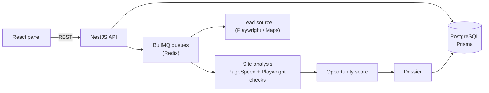

# LeadTracker — Prospecting Pipeline for Freelance Web Work

> Personal tool that finds local businesses, audits their online presence and turns weak or missing websites into qualified sales opportunities with a personalized first contact.

## Highlights

<!-- XYZ: "Accomplished [X] as measured by [Y], by doing [Z]". -->

- **Replaced hours of manual lead research with an automated pipeline**, as measured by a full website audit per lead (speed, responsiveness, HTTPS, visible contact, page purpose) with no manual check, by combining a Playwright lead source, the PageSpeed Insights API and my own Playwright-based checks in background queues.
- **Turned a subjective question ("is this site bad?") into a transparent score**, as measured by 8 opportunity types (no site, site down, no HTTPS, slow, not responsive, no contact, hidden contact, doesn't convert), by splitting the judgement into independent, testable checks.
- **Kept a growing integration-heavy codebase reliable**, as measured by 170+ automated tests and CI on every push, by putting every external service behind a port with a fake for tests and running integration tests against a real Postgres with Testcontainers.

## The story (STAR)

### Situation

Finding freelance clients meant searching Google Maps by hand, opening each business's website, guessing whether it was slow or broken on mobile, and writing every first message from scratch. Most of the time went into research, not selling.

### Task

Build a tool that captures local businesses for any niche and city, audits their online presence, ranks who most needs a website, and prepares the sales argument, so my time goes into talking to the right leads.

### Action

- **Lead capture campaigns:** search any niche + city and collect businesses with website, phone, rating and number of reviews, running as scheduled jobs in BullMQ queues with retries (scraping and analysis are slow and fail often).
- **Website audit:** viewport and horizontal-overflow checks, contact (WhatsApp, phone, e-mail, form) above the fold, page purpose from its text, and mobile/desktop speed from PageSpeed.
- **Opportunity dossier:** no website → offer a new one; slow or broken site → offer an improvement, with problems, arguments, suggested service and price range.
- **Ports and adapters for every external service:** lead source, PageSpeed client, site inspector, LLM, e-mail, WhatsApp and even the clock sit behind interfaces with a real adapter and a fake. The Maps source can later be swapped for the Places API without touching the domain.
- **Deterministic adapter tests** with recorded fixtures (saved PageSpeed responses for fast, slow, mobile-unfriendly and failed runs, and saved HTML).
- **Explicit lead lifecycle:** a state machine (NEW → ANALYZED → CONTACTED → REPLIED → MEETING → PROPOSAL → CLOSED, with LOST and OPT_OUT from any stage) that will drive follow-ups, stopping them as soon as the lead replies.

### Result

- Lead capture, website analysis, scoring and the opportunity dossier are working end to end.
- Next steps: AI-generated first message, e-mail and WhatsApp sending with automatic follow-ups, a kanban by stage, unified inbox and calendar.

## Architecture

## Tech stack

TypeScript · NestJS 11 · Prisma 7 · PostgreSQL · Redis + BullMQ · Playwright · Google PageSpeed Insights API · React 19 · Vite · Jest · Vitest · Testcontainers · Docker Compose · GitHub Actions

## About this repository

The source code is private. This page documents the project, my role and the decisions behind it.
Want something built for your business? [Get in touch](https://schaidenunes.com/).

**My role:** Sole developer: product, architecture, implementation and tests
**Duration:** started October 2026, in active development (40+ commits)
